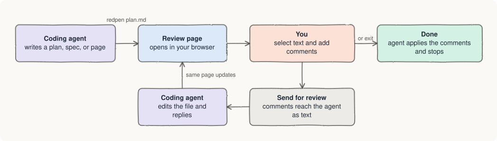

# RedPen

A lightweight, minimalist, and fast review tool for the documents your coding
agent writes.

Open a Markdown, HTML, or text file in your browser. Mark it up with inline
comments, like a red pen on paper. RedPen sends the comments to your coding
agent as plain text. The agent edits the file and replies on the same page.
Repeat until you are happy.

<picture>
  <source media="(prefers-color-scheme: dark)" srcset="docs/review-loop-dark.svg">
  
</picture>

## Why RedPen

- Agents now write plans, specs, reports, and HTML pages. Giving feedback in
  chat means copying quotes by hand.
- RedPen lets you point at the exact line or element and say what to change.
- **Lightweight:** no build step, no framework, and two small dependencies.
- **Minimalist:** one command, one local page, and plain-text output. No
  hooks, no accounts, and no cloud.
- **Fast:** the review page is ready in well under a second.
- It works with any agent that can run a shell command.

RedPen is inspired by tools such as
[Plannotator](https://github.com/backnotprop/plannotator). It is my take on
review: smaller, faster, and focused on one job.

## What it reviews

| Content | Files | Notes |
| --- | --- | --- |
| Markdown | `.md`, `.markdown` | Renders Mermaid diagrams. |
| HTML pages | `.html`, `.htm` | Runs page scripts in a sandbox first, then shows the result. Use `--no-js` for files you do not trust. |
| Plain text | `.txt`, files with no extension | |

RedPen does not review code diffs or pull requests. It rejects all other file
types, including `.mdx`.

## Install

Requirement: [Node.js](https://nodejs.org) 18 or newer.

1. Install RedPen:

   ```sh
   npm install -g redpen-review
   ```

2. Check that it works:

   ```sh
   redpen --version
   ```

3. Add the RedPen skill to your coding agent. Name one or more agents, or use
   `all`:

   ```sh
   redpen install claude
   redpen install claude codex
   redpen install all
   ```

### Supported agents

`redpen install` supports these agents by default:

| Agent | Name | Skill file |
| --- | --- | --- |
| Claude Code | `claude` | `~/.claude/skills/redpen/SKILL.md` |
| Codex | `codex` | `~/.agents/skills/redpen/SKILL.md` |
| OpenCode | `opencode` | `~/.config/opencode/skills/redpen/SKILL.md` |
| Gemini CLI | `gemini` | `~/.gemini/skills/redpen/SKILL.md` |
| Pi | `pi` | `~/.pi/agent/skills/redpen/SKILL.md` |

### Other agents

Any agent that can run shell commands can use RedPen. Add the skill file by
hand:

1. Get the skill file. It is
   [agents/skill.md](https://github.com/aashishd/redpen/blob/main/agents/skill.md)
   on GitHub. After install, a copy is also at
   `$(npm root -g)/redpen-review/agents/skill.md`.
2. Save it in your agent's skills folder as `redpen/SKILL.md`.
3. If your agent has no skills, paste the file's text into its instructions
   file, such as `AGENTS.md`.

### Upgrade or remove

- Upgrade: run `npm install -g redpen-review@latest`, then run
  `redpen install` again for your agents. This updates the skill file.
- Remove: run `redpen uninstall all`, then `npm uninstall -g redpen-review`.

## Use

### With your agent

Ask your agent to review a file, for example:

> redpen it

> Red pen docs/plan.md

The agent runs `redpen <file>`, and the file opens in your browser.

1. Select text, or hover over a paragraph or HTML element and click it.
2. Type your comment and save it. Press `C` to comment on the marked item.
3. Add a general message at the bottom if you want.
4. Choose how to finish:
   - **Send for review**: the agent edits the file or answers, then replies on
     the same page. Review again.
   - **Send feedback and exit**: the agent applies your comments, reports in
     its chat, and the session ends.

### On its own

```sh
redpen notes.md
```

Finish with **Send feedback and exit**. RedPen prints your comments to the
terminal and exits.

| Option | What it does |
| --- | --- |
| `--out <file>` | Also writes the comments to a file. |
| `--port <n>` | Uses a fixed port instead of a random one. |
| `--no-open` | Prints the page address without opening a browser. |
| `--no-js` | Never runs the scripts of an HTML page. |

### Good to know

- RedPen runs on your computer, on a local address. It sends nothing to any
  server. HTML page scripts can still load files from the internet; use
  `--no-js` to stop them.
- Your comments survive page reloads and crashes. Run `redpen <file>` again to
  continue an unfinished review.
- The page has light and dark themes.

## More details

See [docs/reference.md](https://github.com/aashishd/redpen/blob/main/docs/reference.md)
for the report format, the agent reply commands, HTML safety rules, and where
RedPen stores sessions. See [CHANGELOG.md](CHANGELOG.md) for release notes.

## License

[Apache 2.0](LICENSE)
