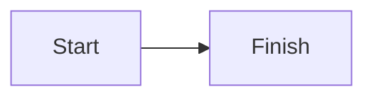

# redpen

Annotate a Markdown, HTML, or plain-text file in the browser with red-pen feedback.
The feedback is printed to stdout so a coding agent can act on it.

redpen is a stripped-down alternative to Plannotator. It has no hooks and no
plan-mode coupling. Run it when you need it, on any file. The only integration
contract is a shell command and its stdout, so it works with any coding agent.

## Install

```sh
npm install -g redpen-review
```

Requires Node 18 or newer. RedPen includes PostCSS for safe local stylesheet rewriting.

## Use

```sh
redpen plan.md
```

Supported files are `.txt`, `.md`, `.markdown`, `.html`, `.htm`, and
extensionless UTF-8 text files. Every other extension, including `.mdx`, `.mmd`,
and `.mermaid`, is rejected before the browser server starts.

Markdown supports fenced Mermaid diagrams:

````markdown

````

Mermaid is only rendered for `.md` and `.markdown` files. RedPen bundles the
official Mermaid 11.17.2 `dist/mermaid.min.js` locally at `ui/mermaid.min.js`.
Its MIT license is at `ui/mermaid.LICENSE`. The bundle adds about 3.6 MB to the
package. Mermaid starts with strict security settings and rejects diagram
frontmatter and every `%%{...}%%` directive, wherever it appears in the source.
Invalid, oversized, or rejected diagrams stay as escaped source with a short
error message.

HTML is rendered as a rich static page in a same-origin sandboxed frame.
RedPen keeps safe markup, inline styles, local stylesheets and nested local
imports, local fonts, native controls, details, raster images, and safe inline
or local SVG. Scripts, form submission, navigation, frames, media, canvas, and
external requests are blocked. Relative paths resolve from the HTML or CSS file.
Root-relative paths resolve from the reviewed document directory. Assets must
remain in that real directory or a subdirectory. Traversal, encoded paths,
symlink escapes, remote URLs, and bad signatures are rejected. Raster and font
files use tokenized, descriptor-checked routes with `no-store` and `nosniff`.
Small image and font data URLs are allowed. Rejected images show a placeholder.
Rejected styles, fonts, and backgrounds show a compact warning in the page.

This starts a local review session on a random localhost port, opens the file
in your browser, and waits for feedback. The browser tab and header use the
same red pen icon. Mermaid is served from that same local server. It has
no CDN, runtime fetch, or external network request. In the browser you can:

- select text and attach an inline comment to it; Save shows `Save (⌘ + ↵)` on macOS or `Save (⌃ + ↵)` elsewhere,
- see each saved annotation marked with a hand-drawn red underline,
- click an annotation to focus it with a red pen band, or edit its comment inline from the comments pane,
- collapse comments with the `>` button on the document divider; the narrow `<` rail keeps clickable red annotation positions and survives reloads in the same browser tab,
- choose **Auto**, **Dark**, or **Light** in the header; Auto follows your operating-system setting,
- **Hover select** starts on for HTML, Markdown, and plain text.
- In HTML, hover marks a visible element, including controls, images, and SVG.
  Click it to comment. Turn off **Hover select** to use safe native interactions.
- In Markdown and plain text, hover marks a paragraph or line. Click it to comment.
- write a message or question above the bottom action buttons,
- see submitted messages on the right and agent replies on the left,
- expand read-only submitted comments and follow references that still match the document,
- Draft messages while the agent replies. Document commenting pauses until the
  reply and any document update finish loading.
- finish with one of two buttons:
  - **Send for review**: the agent answers questions or edits the document, then replies in the same review page. Submitted document marks disappear. Comments stay in collapsed history and cannot be edited.
  - **Send feedback and exit**: the agent addresses the feedback and reports the result in its normal chat. RedPen ends the review session.

History survives page refreshes and review rounds in that session. It is not
saved for future sessions. Document updates keep drafts. **Show in document**
scrolls to an unchanged reference and briefly outlines it. A reference that no
longer matches shows muted **Original text changed** text instead of a link.

On submit, the foreground command prints a report to stdout and exits. For
`revise`, the local server stays running so the same page can receive a reply:

```
ACTION: revise
FILE: /path/to/plan.md
SESSION: http://127.0.0.1:<port>/?t=<session-token>
TURN: 1

## General Comment

...

## Annotations (2)

### Annotation 1

Quote:

> the selected text

Comment:

the user's comment
```

HTML element annotations include a separate Element Context section with a
selector, identity details, visible text, and a short sanitized HTML excerpt.
Manual text selections in HTML also retain an advisory Element Location with the
nearest shared meaningful element's selector and identity details. It has no
visible text or HTML excerpt. Form values, hidden content, event attributes,
unsafe URLs, and session data are excluded.

Status messages go to stderr. Stdout carries only the report. After a revise
submission, the agent uses the report's session URL and turn number:

```sh
redpen reply "<SESSION>" --turn 1 --message "Updated the introduction and fixed the example."
redpen wait "<SESSION>" --after 1
```

Use `--message-file <path>` instead of `--message` for a longer UTF-8 reply.
Replies are plain text. A question can receive a reply without a document edit.
The reply command returns after delivery. The wait command returns the next
feedback report. Repeating the same reply is safe. Repeating a wait returns the
same next report; agents must not apply feedback twice. If the foreground
command is interrupted after submission, use `redpen wait "<SESSION>" --after 0`
to recover the first report, or supply the last completed turn for a later one.

The server holds conversation history in memory until **Send feedback and
exit**. It keeps running if the browser tab is closed without that action, so
reopen the session URL to finish the review. Stopping the initial command before
any feedback also stops its server.

The theme choice is shared by future RedPen sessions. Set `XDG_CONFIG_HOME` to
store it in `$XDG_CONFIG_HOME/redpen/settings.json` on any platform. Without
that override, RedPen uses `~/Library/Application Support/redpen/settings.json`
on macOS, `%APPDATA%\redpen\settings.json` on Windows, or
`~/.config/redpen/settings.json` on other systems.

Options: `--out <file>` also writes the report to a file, `--port <n>` fixes
the port, and `--no-open` prints the URL without opening a browser.

## Agent setup

`redpen install` adds the RedPen native Agent Skill to coding agents:

```sh
redpen install claude codex opencode gemini pi   # or: redpen install all
redpen uninstall all
```

| Agent | Skill file | Native invocation |
| --- | --- | --- |
| Claude | `~/.claude/skills/redpen/SKILL.md` | Activates automatically |
| Pi | `~/.pi/agent/skills/redpen/SKILL.md` | Activates automatically |
| Codex | `~/.agents/skills/redpen/SKILL.md` | `$redpen` or automatic |
| OpenCode | `~/.config/opencode/skills/redpen/SKILL.md` | Activates automatically through its skill tool |
| Gemini CLI | `~/.gemini/skills/redpen/SKILL.md` | Activates automatically; `/skills` manages skills |

The skill tells the agent to run `redpen <file>`, wait for feedback, and act
on the `ACTION:` line. For `revise`, it sends an answer or short change summary
with `redpen reply`, then waits for the next submission with `redpen wait`.
For `close`, it addresses the feedback and ends the loop. Reinstall the skill
after upgrading to update existing agent instructions. It prefers RedPen for
requests to add inline comments or annotations to a supported document,
including “redpen it”, “red pen it”, “red-pen it”, “annotate this document”,
and “add comments to this document”. It does not use RedPen for general
reading, summarization, proofreading, or code review without interactive
document annotation.

## Non-goals

No diff or PR review, no sharing, no saved cross-session history, no hooks,
no build step.
